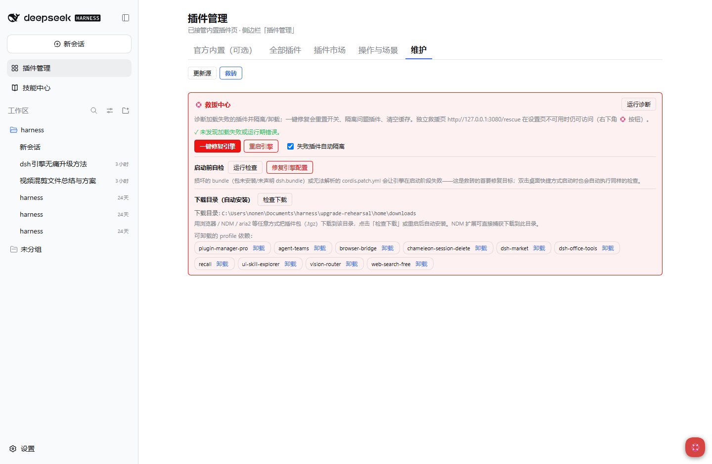

# 独立救援工具链（docs/RESCUE.md）

> 适用版本：**dsh-drydock 1.0.4**。核心卖点一句话：**引擎不可用时，宿主编排的恢复界面（含插件市场内建的恢复面板）能力受限；本工具的差异是进程级的**——救援链跑在独立进程、独立端口，不依赖主引擎是否活着。

## 一、三个工具

| 工具 | 用途 | 用法 |
| --- | --- | --- |
| `bin/open-boot.mjs` | **唯一网页入口 + 常驻守护**（3081）：`/` 是「打开即启动」页；**`/plugins` 是兜底管理页**；`/rescue` 是救援页。设为浏览器主页即「打开即启动」。平时完全隐藏，只有引擎需要拉起时才弹一个可见启动窗口（`--no-window` 可关）。健康判定 = HTTP 握手 + 身份指纹；写接口带 Origin + 一次性令牌防护；`--uninstall` 一键清理（退出码 0/1/2，2 = 归属未确认时不动任何进程） | `npx dsh-drydock` |
| `bin/rescue-daemon.mjs` | **独立备份救援守护**（默认端口 **3082**）：自包含中文救援页 + `verify/fix/start/stop/status` API，不依赖主引擎。**不与 3081 抢端口**（被占时明确报错退出，不静默漂移） | `npx dsh-drydock-rescue`（默认 3082） |
| `bin/dsh-boot.mjs` / `.cmd` | **Steam 式启动序列**：verify → 自动隔离坏插件 → 启动 → 健康等待。`--repair-only` 只自检 + 修复不启动；退出码 0=就绪 / 1=启动失败 / 2=修复未完成；启动即失败会**立即返回**并打印日志绝对路径 | `npx dsh-drydock-boot`（Windows 双击：**包内** `bin\dsh-boot.cmd`） |

装好后三个命令来自 `package.json` 的 `bin` 字段（`dsh-drydock` / `dsh-drydock-boot` / `dsh-drydock-rescue`）；不安装也能用 `npx`，或直接跑包内文件（路径与 cwd 无关）：

```sh
node "$DSH_HOME/profiles/web/node_modules/dsh-drydock/bin/open-boot.mjs" --status
```

共享模块：`lib/preflight.mjs`（独立自检 / 修复，与宿主 `verifyProfile` / `fixProfile` 同源逻辑）、`lib/enginectl.mjs`（引擎探测 / 启动 / 停止 / pid 管理 + 写接口防护）。

## 二、常驻与开机自启

| 命令 | 作用 |
| --- | --- |
| `npx dsh-drydock --supervise [--interval 60] [--heartbeat-min 10]` | **常驻守护**：静默确保 3081 有服务；锁端口（`port+1000`）单实例；只有 HTTP 握手失败才拉起，绝不误杀健康实例。四类日志行（状态变化 / 心跳 / 退出 / 未捕获异常）写入 `profile/open-boot-supervisor.log` |
| `npx dsh-drydock --ensure` | 一次性确保 3081（桌面快捷方式用，退出码 0/1） |
| `npx dsh-drydock --status` | **状态自检 + 健康留痕**：启动器（握手 + 身份）/ 守护（锁端口归属）/ 引擎（3080 握手）/ PID 文件 / cwd / 日志与最后心跳；退出码 0 = 启动器健康；端口属于别人时报告占用 pid。每次追加一行 `profile/health.log`（保留 7 天 / 1000 行） |
| `npx dsh-drydock --install-autostart` | **写开机自启**（Windows）：HKCU `Run\DSHWebFront` + `open-boot-autostart.vbs`（登录静默常驻）与 `open-boot-ui.vbs`（确保 3081 后打开浏览器）。包装脚本正文纯 ASCII 并自解析路径，中文用户名 / 含空格路径不乱码 |
| `npx dsh-drydock --uninstall-autostart` / `--autostart-status` | 移除自启 / 查看状态（shim 是否存在、守护是否存活、端口是否属于本启动器）；未安装时**幂等**（退出码 0） |
| `npx dsh-drydock --uninstall` | **卸载闭环**：三重归属校验停守护（pid 文件 + 锁端口 `port+1000` + 进程镜像；拒绝并绝不动别的进程）→ 删 **所有** `DSHWeb*` Run 值（含历史 `DSHWebRescue`）→ 删两个 `.vbs` shim → 清 `.open-boot.pid`（**日志保留**）。退出码 **0** 完成（含确认「无可清理」）/ **1** 出错 / **2** **归属未确认**（探测不可用：不动任何进程、保留 pid，绝不谎报完成）。引擎 3080 不动。管理器卸载自身前会自动调用它 |
| `npx dsh-drydock --help` / `npx dsh-drydock-boot --help` | 显示用法（未知参数会报错，不再被静默忽略） |

> 完整命令 / 退出码表、`--uninstall` 四步与排错表见 [LAUNCHER.md](LAUNCHER.md) §4；端口分工见 [COMPATIBILITY.md](COMPATIBILITY.md)。

## 三、健康判定与「停引擎」的安全性

- **就绪 = HTTP 握手成功且响应带 dsh 身份指纹**；裸 TCP 监听器一律判不健康。3080 / 3081 / 3082 被别的程序占用时，工具**明确报错而不是假装就绪**，也绝不静默换端口。
- `stopEngine()` 前三重校验（pid 存活 / 进程镜像 / 端口归属），不过一律拒绝；救援页提供「强制停止」（`POST /api/stop {"force":true}`）。
- PID 文件均为 JSON：`profile/.rescue-daemon.pid`（引擎）/ `.open-boot.pid`（启动器）。
- **工作目录**：引擎与启动器使用**稳定 cwd**（默认用户主目录；`--cwd <dir>` 或 `DSH_ENGINE_CWD` 覆盖）。早期版本把 cwd 放在包内，自更新 / 卸载时锁住目录（`ERR_PNPM_EPERM`）。
- ⚠️ **实现注意**：自启包装脚本一律「wscript → node」，不用隐藏 PowerShell（会被部分杀软误判删除）；守护拉起引擎时刻意不加 `windowsHide`。

## 四、救援流程速查

| 症状 | 入口 |
| --- | --- |
| 引擎在跑，但 3080 界面 / 插件页异常 | 3080 右下角 🛟 救援球，或从插件页进入 `http://127.0.0.1:3080/rescue` |
| 引擎起不来、3080 打不开 | `http://127.0.0.1:3081/`：自检 → 修复 → 启动 → 跳转带 token 的入口 URL |
| 插件被禁用到界面起不来 | `http://127.0.0.1:3081/plugins` 直接 toggle（该页不依赖引擎） |
| 某个插件把引擎打挂 | 3081 `/plugins` → mod 体检看 verdict → 禁用观察或卸载（带备份与验证） |
| 卸载 / 更新被引擎占用 | 拒绝硬删并引导：先禁用 → 重启引擎 → 再操作 |
| 需要独立于 3081 的备份救援入口 | `npx dsh-drydock-rescue`（默认 3082，不抢端口） |
| 想知道 3080/3081/3082/4081 到底什么状态 | `npx dsh-drydock --status`（并追加一条 `health.log` 留痕） |
| 命令行一键自检 + 启动 | `npx dsh-drydock-boot`（启动）或 `npx dsh-drydock-boot --repair-only`（只自检 + 修复） |
| 彻底移除启动器 | `npx dsh-drydock --uninstall`（退出码 2 = 归属未确认：不动任何进程） |

排错顺序建议：① 开 `http://127.0.0.1:3081/` →「检查 → 修复 → 启动」；② `npx dsh-drydock-boot --repair-only` 看隔离清单；③ `npx dsh-drydock --status` 看启动器 / 守护 / 引擎真实状态与最后一条 `health.log`；④ 交互式启动 `npx dsh-drydock-boot`。

## 五、救援与自动隔离能力（3080 内）

- **独立救援页 `/rescue`**：自包含 HTML 直连宿主网关，UI 全坏仍可诊断 / 隔离 / 一键修复 / 重启 / 卸载。
- **宿主准入**：引擎内 `/rescue` 与 `/plugins-launcher` 走 `ctx.connection.requestRejection`（未认证 401 / Host・Origin 不符 403 / 判定异常 fail-closed 403）；从应用内进入正常，地址栏直开会被 403 拒绝。详见 [SECURITY.md](SECURITY.md) §4.4。
- **浮动救援球**：右下角 🛟，可拖动换位（位置记忆），设置页损坏时的入口。
- **自动隔离**：可选开关（**默认关**），只隔离**连续失败达阈值**的插件；界面骨架与基础设施条目在保护集内，永不自动禁用。
- **启动前自检**：`verifyProfile` / `fixProfile`——坏 bundle 会在启动阶段拖垮引擎，一键检查与隔离修复。
- **运行期失败条目自动隔离**：启动失败后自动**解析启动日志 → 隔离失败条目 → 重试**；隔离行带备份可逆（3081 的「重启引擎」也会执行一次）。



<sub>**图 1** · 维护页签的「诊断中心」实拍：一键修复引擎 / 重启引擎 / 启动前自检 / 失败插件自动隔离。源图：`docs/images/pm-maintenance-rescue.png`。</sub>

## 六、API 参考（3081）

| 方法 | 路径 | 说明 |
| --- | --- | --- |
| GET | `/api/status` | 启动器 + 引擎状态 |
| POST | `/api/boot` | 自检启动（单飞闸门） |
| POST | `/api/launcher/stop` | 优雅停止本启动器（pid 归属校验） |
| GET/POST | `/plugins/api/bundles` | 列出 / 启停 bundle（写前备份） |
| GET | `/plugins/api/updates` | `pnpm outdated` 投影用户插件 |
| POST | `/plugins/api/update` | 更新单个用户插件（EBUSY 引导） |
| POST | `/plugins/api/uninstall` | 事务性卸载（steps 日志；超时 / 进程不明时标记「未知」不回滚） |
| GET | `/plugins/api/health` | mod 体检（只读） |
| POST | `/plugins/api/engine/restart` | 重启引擎（失败条目自动隔离一次） |
| GET/POST | `/rescue/api/*` | 救援中心 verify / fix / start / stop / status |
| GET | `/rescue` | 引擎内救援页（HTML；经宿主准入） |
| GET | `/plugins-launcher` | 启动器入口信息（JSON；经宿主准入） |

写接口（POST）需要同源 `Origin` + `X-DSH-PM-Token`（页面 meta 自动携带，不落盘、不写日志）；`/rescue` 与 `/plugins-launcher` 另经**宿主准入**（未认证 401、Host/Origin 不符 403、判定异常 fail-closed 403）。3082 还有 Host 校验前置（非回环 Host → 421），见 [SECURITY.md](SECURITY.md) §4.3。

## 七、工作原理

- **独立自检**（`lib/preflight.mjs`）：纯 Node 的 `verifyProfile` / `fixProfile`，不依赖 Cordis 运行时；坏 bundle、重复 loader 条目、补丁残留都能在启动前查出来并隔离修复。
- **引擎生命周期**（`lib/enginectl.mjs`）：探测 3080（HTTP 握手 + 身份指纹）、区分「端口被占」与「引擎没起」、带归属校验的停止 / 强制停止、pid 文件管理。
- **引导解析**：启动失败时读引擎日志尾部，按包聚合失败原因，隔离失败条目后重试一次（隔离行带 `.rescue-bak-*` 备份，可撤销）。
- **token 入口 URL**：从 `<DSH_HOME>/logs/web.log` 提取带 token 的入口链接并跳转。

> 三进程架构（3080 / 3081 / 3082）、守护锁 `port+1000`、槽位契约见 [ARCHITECTURE.md](ARCHITECTURE.md)。

## 八、已知限制

1. **入口 token URL 依赖日志落盘**：只有引擎 stdout 落到 `<DSH_HOME>/logs/web.log` 时 3081 才拿得到可直接跳转的链接（启动器经 `enginectl` 拉起时正常落盘）。若引擎由其他路径拉起（如 `dsh-boot` 的弹窗路径），3081 可能给不出链接——到 `/rescue` 执行一次「重启引擎」即可恢复。
2. **开机自启管理仅 Windows**（macOS / Linux 用 `--supervise` + 自己的服务管理器）。
3. **端口不漂移是有意设计**：被占用即报错，需要你手工处理占用者或改端口。
4. 3080 / 3081 / 3082 只绑回环地址，跨机器访问不在支持范围。
