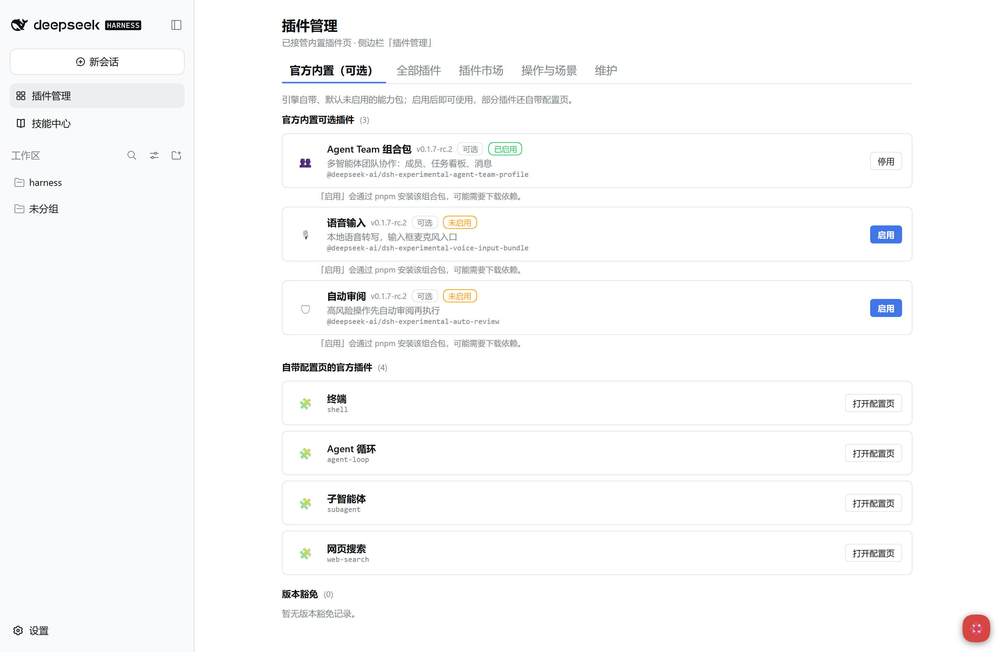
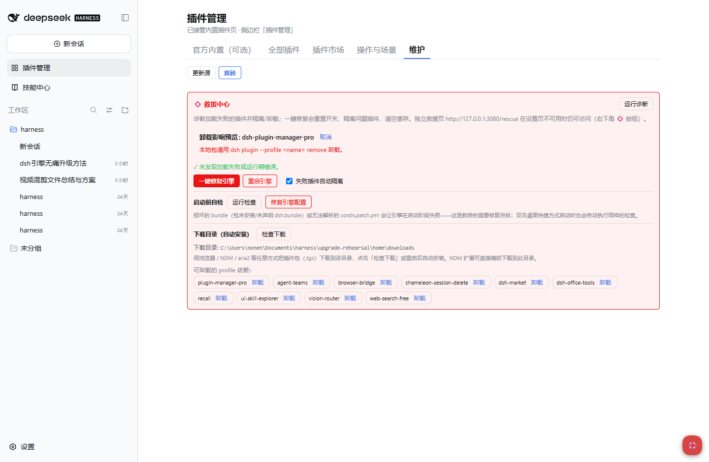

# 使用说明：管理台 / 事务化卸载 / 下载 / 市场 / 兜底页（docs/USAGE.md）

> 适用版本：**dsh-drydock 1.0.4**。安装与更新见 [INSTALL.md](INSTALL.md)；救援工具链见 [RESCUE.md](RESCUE.md)；安全口径见 [SECURITY.md](SECURITY.md)。

## 一、载体一览

| 载体 | 入口 | 说明 |
| --- | --- | --- |
| **管理台（3080）** | `http://127.0.0.1:3080` → 侧边栏「插件管理」 | 接管引擎内置插件页；功能最全的日常入口，跟随 DSH 主题变量 |
| **兜底页（3081）** | `http://127.0.0.1:3081/plugins` | 纯 Node 进程托管，不依赖引擎运行；扁平设计，深浅主题（自动跟随引擎外观与系统偏好） |
| 启动页（3081） | `http://127.0.0.1:3081/` | 打开即自检并启动引擎（浏览器主页设为它 =「打开即启动」） |
| 救援球 🛟 | 3080 右下角浮动按钮 | 可拖动换位（位置持久记忆），单击打开救援页 |
| 救援页 | `http://127.0.0.1:3081/rescue` | verify / fix / start / stop / status 全套修复能力 |

**本管理器接管引擎内置的插件管理页，并补上官方不做的部分**：装卸的完整闭环（影响预览 → 事务化卸载 → 失败回滚 → 一键撤销）、操作历史与场景方案、引擎不可用时依然可用的兜底管理页，以及主引擎起不来时的独立救援工具链。任一载体失效时，其余载体仍可完成启停、卸载与恢复操作。

**图 1** · 独立插件页实拍：侧边栏一级入口「插件管理」，页签为 官方内置（可选）· 全部插件 · 插件市场 · 操作与场景 · 维护。1.0 起列表内部改为来源三分区，页签结构不变。源图：`docs/images/pm-090-official2.png`。

## 二、管理台（3080）

### 2.1 分区模型（1.0 起）

插件列表按来源分三区，语义与引擎实际情况一一对应：

| 分区 | 判定 | 行为 |
| --- | --- | --- |
| **核心组件（引擎必需，不允许禁用）** | 包名白名单（dsh-base / dsh-web-app） | 锁定展示，开关与卸载均拒绝 |
| **引擎内置组件** | 引擎自带（origin=builtin） | 可启停、可查看；行徽章「内置」，区内按名称排序 |
| **用户插件** | 用户安装（origin=user） | 完整操作：启停 / 更新 / 卸载 / 配置 |

- 「推荐」不再是分区，而是**行内标签**：仅真正的第三方推荐加装件（如 browser-control）显示，重要引擎组件不再混入推荐清单。
- 来源筛选（全部 / 架构自带 / 用户安装）、搜索、分区折叠与计数互相联动。
- **来源人工修正**：自动判定来源标签（npm / GitHub / 本地 / 内置），每行可手动覆盖并持久化。
- **状态一目了然**：启用状态（🔴 错误 / 需检查 · 🟡 需更新 · ⚪ 未启用 · 🟢 启用）、名称、功能简介、已装→最新版本 + 来源、开关按键。
- **简介自动提取**：内置中文目录优先；未收录的 mod 自动从 `README.zh.md`（优先）/ `package.json.description` / `README.md` 提取一句话简介。
- **核心保护**：核心组件白名单行禁止开关与卸载（🔒 标记）。

### 2.2 页签

- **官方内置（可选）**：引擎自带、默认未启用的组合包一键启用 / 停用 + 版本豁免
- **全部插件**：插件清单（见分区模型）
- **插件市场**：ADP 精选目录，一键安装（见 §5）
- **操作与场景**：事务化卸载与影响预览、**卸载前体检**、操作历史一键撤销、场景方案
- **维护**：更新源与刷新、启动前自检、救援中心入口、下载目录

行内操作：启停开关（写前自动备份）、市场详情、卸载（卸载前体检预览）、配置页（运行时 slot 注册的插件）。

第三方配置入口有落点：插件行内一行摘要，展开即是它自己的完整配置卡片（`plugins.row.config` / `plugins.bundle.config` 槽位）；未注册槽位的插件不会出现空按钮。

### 2.3 管理器自身的禁用与卸载（统一口径）

管理器不能在自身管理界面（3080）中停用自己；如需禁用或卸载，请前往启动器兜底页（3081 `/plugins`）或使用 `dsh` 命令行——兜底页独立于引擎存活，禁用后仍可恢复。

3080 内允许的例外是**卸载**：走额外警告路径，卸载前自动清理开机自启，结果写入卸载报告；卸载后 3080 管理界面消失、3081 兜底页存活至启动器进程结束。

## 三、事务化卸载、历史与场景

- **卸载影响预览**：卸载前展示「影响范围」——依赖该包的已安装插件（`dependencies` / `peerDependencies` 反向图）、将移除的插件条目、将清理的开关行、bundles 声明。
- **事务化卸载**：备份 `package.json` + `cordis.patch.yml`（`.rescue-bak-*`）→ `pnpm remove` + 清理补丁条目 + 移除 bundles / 开关行 → 逐项验证 → **任何失败自动回滚**；Windows 文件锁残留目录登记 `pendingRemovals`，下次启动自动清理。
- **加固（1.0）**：`pnpm remove` 超时或进程状态不明时**不**盲目回滚——标记「未知」请人工确认，避免把半删状态变成更坏状态；EBUSY 引导（引擎运行中且目标启用时拒绝硬删，提示「先禁用 → 重启引擎 → 再操作」）。
- **卸载报告**：自检结果、清理开关行数、级联卸载包、残留列表；支持级联卸载依赖它的可卸载包。
- **卸载前体检（0.9.1）**：预览里给出**结论行**（安全 / 需注意 / 有风险 + 一句理由），并列出三类检查——① 依赖断裂 ② `cordis.patch.yml` 补丁残留（**只提示、绝不自动删**）③ service 与端口冲突。
- **操作历史**：最近 20 次操作（卸载 / 启停 / 隔离 / 场景应用 / 重置开关），一键撤销，侧车持久化跨重启。
- **场景方案**：把当前启停状态保存为命名场景（如「办公 / 写作 / 演示」），一键应用——先展示**变更预览**，确认后切换；可更新、删除。
- **卸载管理器自身前先清理自启**：删包之前先调用包内 `bin/open-boot.mjs --uninstall`（旧版本无该能力 → 记为「已跳过」，不阻断卸载）。

**图 2** · 事务化卸载的**影响预览**实拍（彩排环境，2026-09-28）：在改动 `package.json` 之前先给出「会影响什么」；同一张「诊断」卡片还带救援入口（修复引擎 / 重启引擎 / 启动前自检 / 失败插件自动隔离）。源图：`docs/images/pm4-uninstall-preview.png`。

## 四、更新与下载

更新源的**完整信任模型**见 [SECURITY.md](SECURITY.md) §3，这里只列使用要点：

- **默认三源**：npm 官方 `registry.npmjs.org` / GitHub 官方仓库 / npmmirror 镜像 `registry.npmmirror.com`；registry 版本权威，自定义源默认只兜底（`authoritative: false`），不与官方混比。
- **只有 `@deepseek-ai/*` 有 `next` 轨道**：其余包只取 `latest`，`latest` 本身是预发布（含 `-`）时视为「无可用版本」，不把 RC 推给普通用户。
- **限流熔断**：GitHub API 403/429 自动冷却 10 分钟；全量刷新 8 并发、结果缓存 30 分钟。
- **下载优先级**：① 浏览器原生下载（隐藏 iframe，NDM 等扩展可捕获）→ ② 外部下载软件 → ③ 内置下载器兜底（HTTP 直链 / aria2c / P2P magnet·torrent）。
- **下载目录自动安装需来源记录（provenance）**：`.tgz` / `.tar.gz` 放进 `$DSH_HOME\downloads` 后，先读归档内 `package.json`，只有能与管理器自己生成的下载记录（包名 + 版本 + 来源 + 期望摘要，7 天有效）对上才自动安装；对不上的拒绝并写 `.failed`（提示「未找到来源记录——不是本管理器生成的下载链接；确认可信后再删除 .failed 重试」），安装成功后记录移除。
- **校验口径**：只有内容摘要（integrity / shasum）才算「已校验」，**字节数单独存在不算**；重定向逐跳校验，任何一跳降级到明文 `http` 都拒绝（除非显式 `allowInsecure`）；无摘要的下载默认拒绝，`security.unverifiedDownloads: allow` 放行时回执也会明说「未校验」。

## 五、插件市场

- **ADP 精选目录**：数据来自 awesome-dsh-plugin 收录池，带本地化描述 / 星标 / 收录日期与分类；条目数随上游变化，host 端 10 分钟缓存；离线时回退 GitHub `topic:dsh-plugin` 搜索。
- **零往返过滤**：目录一次拉全量，搜索 / 分类 chips / 排序 / 分页全部客户端本地完成。
- **一键安装**：带 npm 名的条目优先 **npm registry 直装**；GitHub 仓库走内置下载器；两步确认防误触；已装 ✓ 徽标。
- **装后防砖校验**：自动验证 `dsh.bundle` / `dsh.client` 清单，缺失自动卸载；pnpm hoist 漂移 / `minimumReleaseAge` 陷阱自动恢复。

## 六、兜底页（3081 `/plugins`，1.0 新增）

引擎不可用时依然可用的管理入口（纯 Node 进程托管，扁平设计 + 深浅主题）：

- **启停 / 更新 / 卸载**：toggle 写 `dsh.profile.bundles`（写前备份）；`pnpm outdated` 批量比对、逐个更新；事务性卸载（同上，每步落日志）。
- **mod 体检**：只读 preflight + 引擎日志尾部按包聚合，verdict 三档（ok / suspect / broken）。
- **重启引擎 / 停止启动器**：确认框 + toast，写接口全部走 Origin + 一次性令牌防护。
- **有意不做**：行内配置面板、场景管理、下载诊断（依赖引擎 Cordis 运行时，与兜底页定位冲突）——完整功能在 3080 管理台。

## 七、插件页接管与开关持久化（实现口径）

- **插件页接管**（`src/client.jsx` + `cordis.patch.yml`）：客户端注册进 `main`（key=`plugins`）与 `sidebar.panellist`（id=`plugins`），patch 停用内置 `ui-plugin-manager`；用自己的行 id `drydock` 不与官方同名；注册内置页原有的 `plugins.*` 子槽位，第三方配置卡片有真实渲染出口。
- **开关持久化**：写入 profile 的 `cordis.patch.yml`（带归属注释行，不触碰用户自有补丁；旧包名时代的归属标记仍可识别）。
- **来源三分区判定**：核心组件 = 包名白名单；内置 / 用户 = 引擎 origin 字段（origin=builtin / origin=user），与引擎实际状态一一对应。
- **运行期错误**：从 cordis 的 `fiber._error` 取真实错误文本（诊断与救援页能看到失败原因）。
- **收敛判定**：基于真实引擎字段（`Entry.disabled` / `_initTask` / `fiber.state`），**不收敛时如实提示需要重启，不谎报**。

> 进程 / 槽位 / 侧车字段 / 卸载事务数据流的完整设计见 [ARCHITECTURE.md](ARCHITECTURE.md)。
